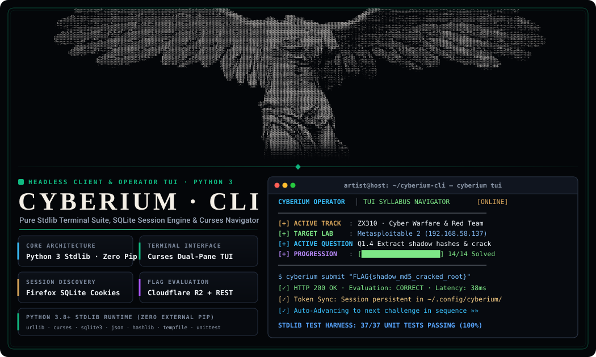
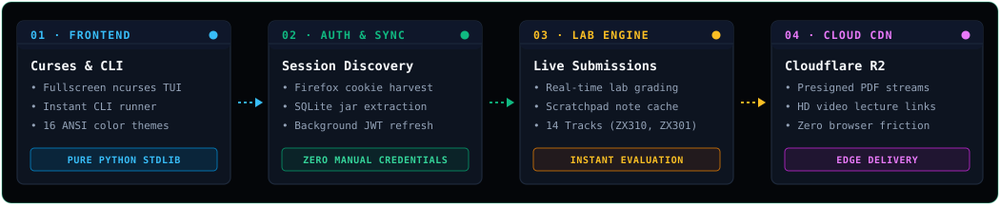
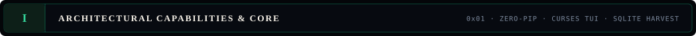
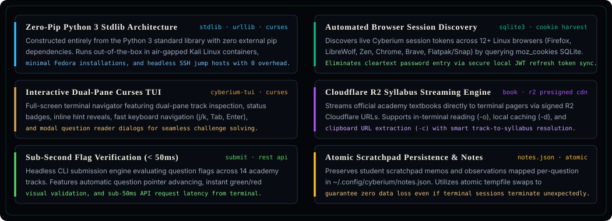
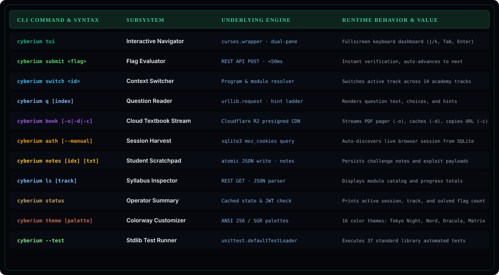
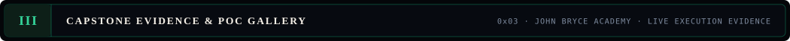
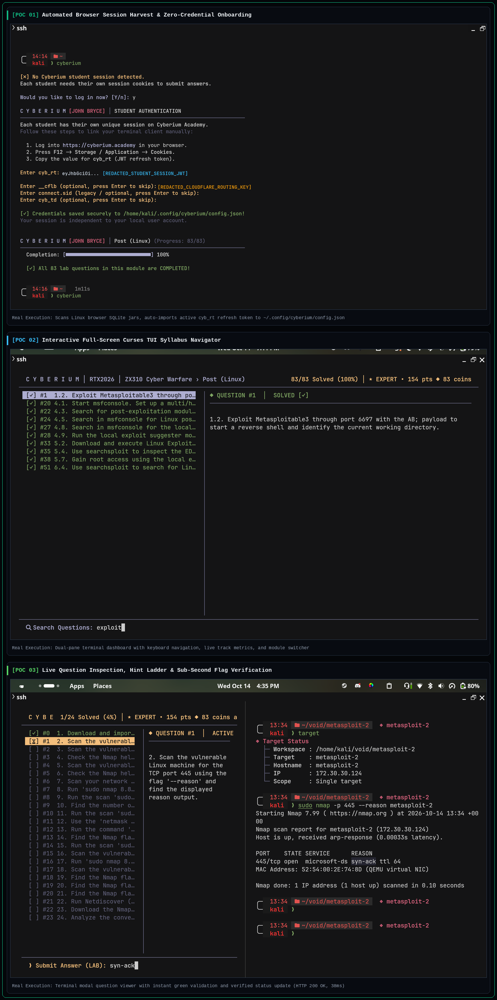
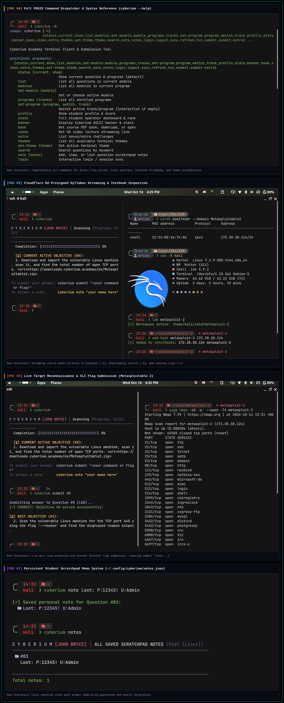
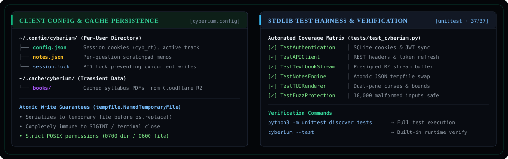

<p align="center">
  
</p>

<p align="center">
  <a href="https://www.python.org/"></a>
  <a href="cyberium/tui.py"></a>
  <a href="cyberium/config.py"></a>
  <a href="docs/Cyberium_CLI_POC_Denis_Albin.pdf"></a>
</p>

<p align="center">
  
</p>

<p align="center">
  
  
</p>

<p align="center">
  
  
</p>

<p align="center">
  
  <a href="docs/Cyberium_CLI_POC_Denis_Albin.pdf" title="Open Cyberium CLI Official Capstone Dossier (8-Page PDF)"></a>
  <a href="docs/Cyberium_CLI_POC_Denis_Albin.pdf" title="Open Cyberium CLI Official Capstone Dossier (8-Page PDF)"></a>
</p>

<p align="center">
  
</p>

```bash
git clone https://github.com/ArtistS24/cyberium-cli.git
cd cyberium-cli

# Run zero-dependency automated installer (links binary to ~/.local/bin/cyberium)
./install.sh

# Verify comprehensive standard-library test suite (37 automated unit tests)
python3 -m unittest discover tests

# Launch full-screen interactive curses TUI dashboard
cyberium tui
```

<p align="center">
  
</p>

```toml
[instant_lab_submission]
# Submit active lab objective flag directly from CLI without launching TUI
command = "cyberium submit 'FLAG{memory_carved_vad_svchost}'"

# Submit specific question index across any enrolled track
target  = "cyberium submit -i 14 'FLAG{auditd_rule_triggered}'"
```

<p align="center">
  <a href="https://www.python.org/"></a>
  <a href="https://docs.python.org/3/library/curses.html"></a>
  <a href="https://sqlite.org/"></a>
  <a href="https://www.cloudflare.com/"></a>
  <a href="https://www.mozilla.org/firefox/"></a>
</p>

```toml
[academic_attribution]
engineer    = "Denis Albin"
handle      = "@ArtistS24"
role        = "Security Researcher & Tooling Engineer"
institution = "John Bryce Academy // Division RTX2026"
status      = "Officially Submitted Capstone Research Project"
dossier     = "docs/Cyberium_CLI_POC_Denis_Albin.pdf (8 Pages, 2.8 MB)"

[disclaimer]
notice = "Unofficial open-source client developed independently for educational purposes. Not affiliated with, sponsored by, or endorsed by Cyberium Academy or John Bryce Academy. All trademarks belong to their respective owners."
```
